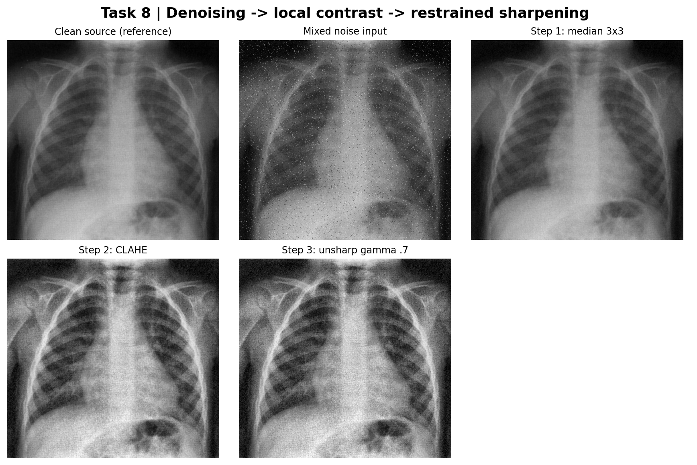

# EE3005 Image Processing — Assignment 2

**Biomedical image enhancement, spatial filtering, denoising, sharpening, and edge detection**

[](#)
[](#matlab-implementation)
[](#python-reference)
[](#execution-status)
[](#scope-and-limitations)

| | |
|---|---|
| **Author** | Burak Bekir Çakırer (Student ID 2211011008) |
| **Course** | EE3005 — Biomedical System Design Capsule-S1 |
| **Deliverable** | Image Processing Assignment 2, Tasks 1–8 |
| **Repository** | https://github.com/burakcakirer/ee3005-image-processing-assignment-2 *(available after publication)* |

---

## Overview

This repository provides a reproducible set of image-processing experiments on course-supplied biomedical images (a chest radiograph and a brain MRI). It contains:

- a **MATLAB** implementation of Tasks 1–8,
- an independently executed **Python reference** that generated all reported numbers and figures,
- fixed input images and deterministic noise realizations,
- quantitative results, validation tests, and
- a full report in **PDF, DOCX, and Overleaf-ready LaTeX**.

The report presents methodology, equations, hand calculations, results, figures, and interpretation. It intentionally contains **no code listings**; the source is available in `MATLAB/`, `Python_Reference/`, and `tools/`.



<sub>Task 8 — integrated pipeline. All images are for coursework and are not intended for diagnostic use.</sub>

## Execution status

> **Important:** All numerical results and figures were produced by the **executed Python reference** and checked for internal consistency. The MATLAB implementation is supplied for the assignment but **has not been executed in MATLAB**. Library differences (notably CLAHE implementations and boundary handling) may change MATLAB outputs slightly. Do not describe results as MATLAB-verified until the `.m` script has been run and compared.

## Tasks

| # | Topic | Experiment |
|:-:|---|---|
| 1 | Histogram equalization, AHE, CLAHE | Global vs. local contrast, two CLAHE configurations, histograms, local contrast metrics |
| 2 | Correlation, convolution, borders | Hand-calculated center-pixel outputs; zero, replicate, reflect, circular padding |
| 3 | Separable Gaussian filtering | 2D vs. two 1D passes; maximum difference and operation count |
| 4 | Linear denoising | Gaussian and salt-and-pepper noise; mean/Gaussian filters; PSNR comparison |
| 5 | Nonlinear filtering | Median, geometric/harmonic means, contra-harmonic (polarity and order) |
| 6 | Unsharp masking | Three gain levels; detail enhancement vs. over-sharpening |
| 7 | Edge detection | Sobel, Laplacian, LoG, DoG; noise sensitivity and scale |
| 8 | Integrated pipeline | Median → CLAHE → unsharp masking with intermediate results and critical evaluation |

## Key results

| Measurement | Result |
|---|---:|
| Task 2 — central correlation output | **−80** |
| Task 2 — central convolution output | **+80** |
| Task 3 — max. difference, 2D vs. separable | **≈ 3.33 × 10⁻¹⁶** |
| Task 3 — multiplications per pixel (3×3) | **9 → 6** |
| Task 4 — best tested filter, Gaussian noise | **3×3 Gaussian (σ = 0.8), 30.74 dB** |
| Task 5 — salt-and-pepper, median 3×3 vs. mean 3×3 | **34.88 dB vs. 23.03 dB** |

PSNR is computed against the clean reference using stored noise realizations. A higher PSNR does not necessarily mean better clinical visibility, since contrast operations intentionally alter the intensity distribution. Complete tables are in the report.

## Quick start

### MATLAB implementation

**Requirements:** MATLAB (R2020a or newer recommended) with the Image Processing Toolbox.

1. Open `MATLAB/run_assignment2.m`.
2. Click **Run** (no path changes needed; paths are resolved relative to the script).
3. Figures are written to `Outputs/MATLAB_Figures/`, data to `Outputs/MATLAB_Results/`.

The script loads the bundled PNGs in `Source_Images/Prepared_Inputs` so that noise realizations are identical across environments. Review MATLAB output separately before claiming equivalence with the Python reference.

### Python reference

**Requirements:** Python 3.10+ (NumPy, SciPy, scikit-image, OpenCV, Pillow, Matplotlib). Run from the repository root:

```powershell
py -m venv .venv
.\.venv\Scripts\Activate.ps1
python -m pip install -r Python_Reference/requirements.txt
python Python_Reference/reproduce_results.py
python Tests/validate_outputs.py
```

If PowerShell blocks activation, call the interpreter directly: `.\.venv\Scripts\python.exe Python_Reference\reproduce_results.py`.

The script uses RNG seed `3005`, rebuilds the prepared and noisy images, writes data to `Outputs/Results/`, and regenerates the 11 figures in `Report/Figures/`.

### Validation

```powershell
python Tests/validate_outputs.py
python Tests/check_report_policy.py
```

The tests verify Task 2 hand calculations, 2D/separable Gaussian agreement, noise and filter comparisons, expected figures, and grayscale input formats, as well as the absence of code listings in the report. They confirm **reference-data consistency**, not MATLAB runtime correctness.

## Repository structure

```text
ee3005-image-processing-assignment-2/
├── MATLAB/
│   └── run_assignment2.m             # MATLAB implementation (Tasks 1–8)
├── Python_Reference/
│   ├── reproduce_results.py          # Reference experiments and figure generator
│   └── requirements.txt
├── Source_Images/
│   ├── Original_Samples/             # Instructor-supplied examples (incl. DICOM)
│   └── Prepared_Inputs/              # Grayscale and deterministic noisy PNGs
├── Outputs/
│   └── Results/                      # CSV, JSON, manual calculation log
├── Report/
│   ├── EE3005_Assignment2_Report.pdf
│   ├── EE3005_Assignment2_Report.docx
│   ├── main.tex                      # Overleaf-ready, code-free
│   ├── Figures/                      # 11 report figures
│   └── README_OVERLEAF.md
├── Original_Assignment/
│   └── Assignment_2_Instructions.pdf
├── Tests/
│   ├── validate_outputs.py
│   └── check_report_policy.py
├── tools/
│   └── build_report.py               # Regenerates DOCX and main.tex
└── docs/
    └── GITHUB_DESKTOP_TR.md          # GitHub Desktop walkthrough (Turkish)
```

Keep the relative layout intact: scripts locate inputs and outputs relative to their own position.

## Report

| File | Purpose |
|---|---|
| [`EE3005_Assignment2_Report.pdf`](Report/EE3005_Assignment2_Report.pdf) | Read-ready PDF |
| [`EE3005_Assignment2_Report.docx`](Report/EE3005_Assignment2_Report.docx) | Editable Word version |
| [`main.tex`](Report/main.tex) | Standalone Overleaf source (pdfLaTeX) |
| [`Figures/`](Report/Figures/) | Figures used by the report |

To rebuild the DOCX and LaTeX after editing results or text:

```powershell
python -m pip install python-docx
python tools/build_report.py
```

The builder does **not** re-export the PDF; export the updated DOCX manually (e.g., Word → *File → Export → Create PDF/XPS*). Overleaf instructions: [`Report/README_OVERLEAF.md`](Report/README_OVERLEAF.md).

> **Submission note:** The assignment guidelines mention a single Word report together with MATLAB source. This repository separates code from the report by design. Follow your instructor's actual LMS submission requirements.

## Experimental setup

| Item | Setting |
|---|---|
| Images | `image3.jpg` (chest radiograph), `image2.jpg` (brain MRI) from the supplied archive |
| Representation | 8-bit grayscale, normalized to [0, 1] |
| Noise (Tasks 4–5) | Gaussian σ = 0.06; salt-and-pepper density 0.08; separate salt and pepper inputs |
| Noise (Task 8) | Gaussian σ = 0.03 + impulse density 0.025 |
| Metric | PSNR against the clean image, identical shapes, explicit kernel sizes and strengths |
| Reproducibility | RNG seed 3005; stored noisy PNGs |

## Scope and limitations

- Results are **educational image-processing demonstrations**. No clinical labels, diagnostic validation, patient metadata, or external ground truth are used.
- Python (SciPy) and MATLAB (`imfilter`) boundary modes are documented separately; CLAHE implementation details and rounding may differ between them.
- Two DICOM files are included but not analyzed.

## Data rights and publishing

Source images and the assignment PDF come from course materials, and their public redistribution rights are not established. Before making the repository **public**, obtain permission or remove restricted assets; a **private** repository is preferable if in doubt. No software license is asserted.

The report links to `https://github.com/burakcakirer/ee3005-image-processing-assignment-2`. To use a different name, update `REPOSITORY_URL` in `tools/build_report.py`, rebuild the report, and re-export the PDF. For publishing steps with GitHub Desktop, see the [Turkish guide](docs/GITHUB_DESKTOP_TR.md). Do not nest the project inside a second folder of the same name.

---

**Burak Bekir Çakırer** · EE3005 — Biomedical System Design Capsule-S1 · Assignment 2 · 2211011008
